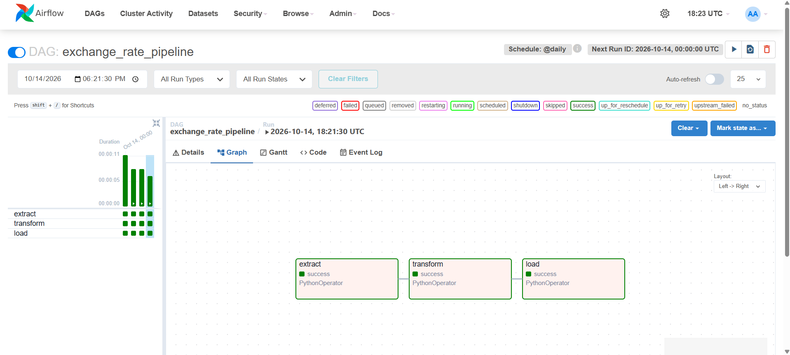

# Airflow Exchange Rates

This project uses Apache Airflow to run a daily exchange-rate pipeline. The DAG extracts the latest USD exchange rates from the ExchangeRate API, transforms the USD, LKR, EUR, and GBP values, and loads them into a local SQLite database.

## Tools Used

- **Apache Airflow** for scheduling and orchestrating the pipeline
- **Docker Compose** for running Airflow and its supporting services
- **Python** for the extraction, transformation, and loading logic
- **SQLite** for storing the cleaned exchange rates

## How to Run

8. Make sure Docker Desktop is installed and running.
9. Open PowerShell in the project directory:

   ```powershell
   cd D:\Coding\airflow-exchange-rates
   ```

10. Start the Airflow initialization service:

	```powershell
	docker compose up airflow-init
	```

13. Start the Airflow services in the background:

	```powershell
	docker compose up -d
	```

14. Open [http://localhost:8080](http://localhost:8080) and sign in with the credentials configured by the Docker Compose file. The default credentials are `airflow` / `airflow`.
15. In the Airflow web UI, enable and trigger the `exchange_rate_pipeline` DAG. The tasks run in this order: `extract` -> `transform` -> `load`.
16. Confirm the run succeeds. The generated JSON files and SQLite database are stored in `data/`, and task logs are stored in `logs/`.

## DAG Graph


